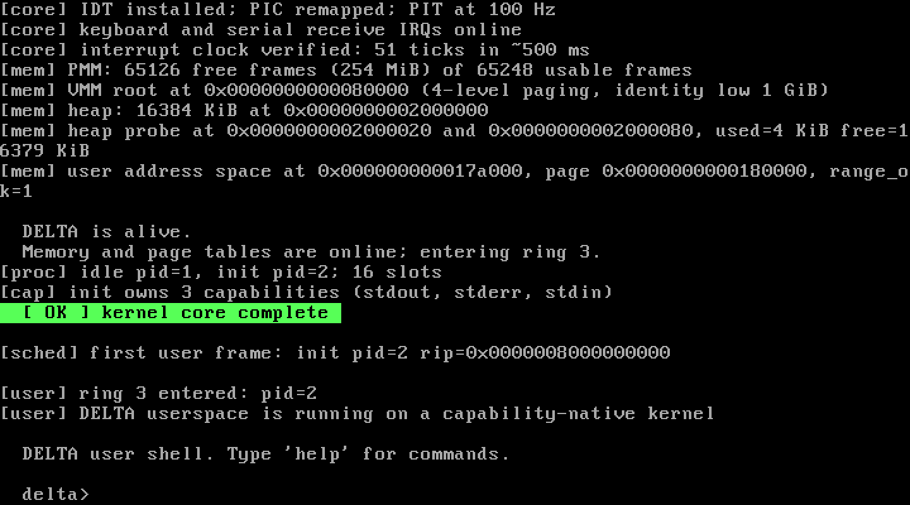
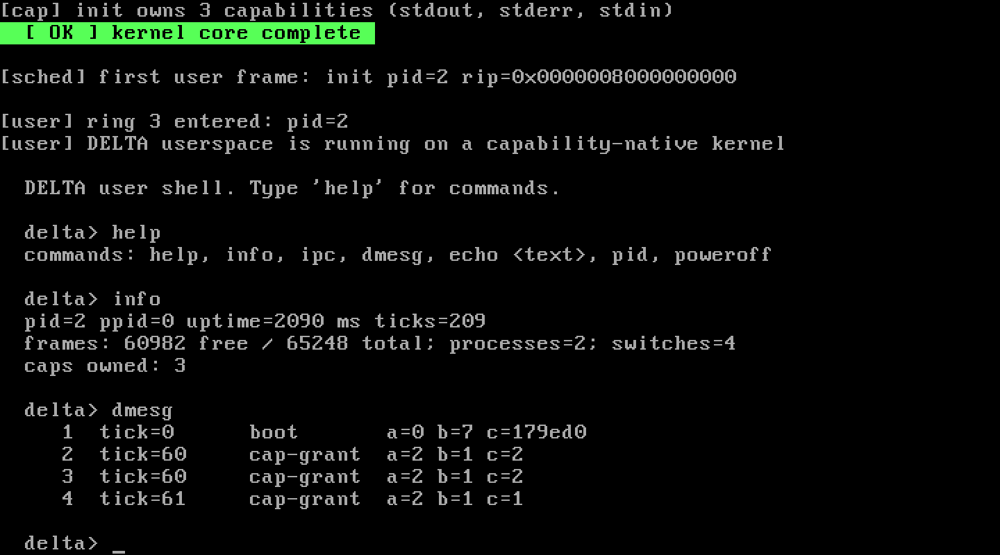

# DELTA

**A capability-native operating-system kernel built from scratch for x86-64.**

DELTA does not start from Linux, Windows, Multiboot, GRUB, or an existing
kernel. It brings itself up from a 512-byte BIOS boot sector, enters long mode,
builds its own page tables, and runs a static ELF `init` in ring 3. Every
resource the kernel knows about is a typed object, and every right a process
holds is an explicit, attenuable capability.

```
          /\
         /  \         D E L T A
        / /\ \        capability-native operating system kernel
       / /  \ \
      / /____\ \
     /__________\
```





**Status: v0.1.0 “First Light” — bootable, tested kernel core, not a finished
operating system.** See [Honest status](#honest-status) before reading the
compatibility claims.

---

## What actually works

The built image boots under QEMU BIOS and passes an automated self-test:

| Area | Implemented in v0.1 |
|---|---|
| Boot | Custom MBR stage 1, custom stage 2, E820 memory map, A20, protected mode, PAE, long mode, 2 MiB identity map, flat kernel image |
| CPU | GDT, 64-bit TSS, IDT, 256 vectors, exceptions, PIC remap, PIT at 100 Hz |
| Console | VGA text mode, scrolling, colours, 16550 UART, PS/2 keyboard, serial RX interrupts |
| Memory | 4 KiB physical frame bitmap (1 GiB window), reserved regions, 16 MiB kernel heap with split/coalesce, 4-level paging, per-process address spaces, NX/W^X user mappings |
| Userspace | Ring 3, static ELF64 loader, 16 KiB kernel stacks, 16 process slots, embedded `init`, `worker`, `spinner`, `idle` ELF images |
| Objects | Console, endpoint, process, memory object types; 32-capability tables; read/write/send/receive/execute/admin/transfer rights |
| IPC | Endpoint message queues, direct rendezvous, capability inheritance at spawn, blocking receive |
| Scheduling | Preemptive priority-band round robin, explicit time slices, timer accounting, sleep queues, idle process, context switching with address-space reload; verified with two CPU-bound user processes |
| Syscalls | 25 syscall numbers, 23 implemented (debug/sbrk reserved): exit, write/read, yield, getpid/getppid, sleep, time, IPC, spawn/wait, close/dup, idle, info, event log, poweroff, boot flags, capability inspection, priority |
| Observability | In-kernel 128-entry event ring, `dmesg` in the shell, boot trace over serial |
| Testing | `python build.py test` boots a separate test image, verifies ring 3 + spawn + capability transfer + IPC + scheduler + deterministic poweroff, and requires `SELFTEST: PASS` |

The QEMU self-test currently prints:

```
[selftest] DELTA verification sequence
  ring3       : pid=2
  capabilities: 3 handles
[worker] received: hello over a capability
ipc: worker 3 exited with 42
  ipc         : endpoint message delivered
preempt: spinner 4 exited with 7
  preempt     : timer-driven address-space switch verified
  scheduler   : sleep/wake completed
SELFTEST: PASS
```

The interactive image provides a small ring-3 shell:

```
delta> help
  commands: help, info, ipc, dmesg, echo <text>, pid, poweroff
delta> info
  pid=2 ppid=0 uptime=2230 ms ticks=223
  frames: 61003 free / 65248 total; processes=2; switches=4
  caps owned: 3
```

---

## Build and run

### Requirements

- Python 3.10+
- QEMU 8+ with the x86-64 system emulator
- Zig 0.13 and NASM 2.16 for the toolchain

The repository is currently laid out for a **self-contained local toolchain**
in `tools/`. First run:

```powershell
python scripts/bootstrap_tools.py
```

`build.py` looks for:

```
tools/zig-windows-x86_64-0.13.0/zig.exe
tools/nasm-2.16.01/nasm.exe
C:\Program Files\qemu\qemu-system-x86_64.exe
```

Any of these can be overridden with `ZIG`, `NASM`, and `QEMU` environment
variables. On a Unix-like host, put `zig` and `nasm` on `PATH`; the same
`build.py` works.

```powershell
python build.py build      # build the kernel and both disk images
python build.py test       # boot the test image and assert SELFTEST: PASS
python build.py run        # interactive QEMU window (VGA + serial)
python build.py clean
```

Outputs:

```
build/images/delta.img        interactive image
build/images/delta-test.img   self-test image
build/kernel/delta.elf        linked kernel ELF
build/kernel/delta.bin        flat kernel payload
build/user/init.elf           embedded ring-3 init
```

The disk image is a raw BIOS disk, not an ISO. It is deliberately simple:
LBA 0 is the boot sector, LBA 1–16 are stage 2, LBA 17 is the kernel header,
and LBA 18 onward is the kernel payload.

For a headless serial console, run QEMU directly:

```powershell
& "C:\Program Files\qemu\qemu-system-x86_64.exe" `
  -m 256M -drive format=raw,file=build/images/delta.img -boot c `
  -serial stdio
```

---

## Design in one page

DELTA is built around four commitments.

### 1. No ambient authority

A process cannot name a resource by a global integer, path, or PID and then
operate on it. It must hold a capability: a slot in its own table that points
to a typed kernel object and carries a rights mask. The kernel rejects an
operation if the slot is empty, the object type is wrong, or the required
right is absent. Capabilities are inherited at `spawn` time and can be
attenuated with `cap_dup`; there is no uid 0 and no global “admin” bypass.

### 2. Mechanism in the kernel, policy in user space

The kernel implements objects, address spaces, scheduling, IPC, and interrupt
delivery. It does not implement a registry, a POSIX VFS, a Windows driver
model, or a desktop. Those are services built on top of the same object and
endpoint primitives. That is how DELTA intends to host Windows and POSIX
*personalities* side by side without turning the kernel into a compatibility
dump: the personality is a replaceable user-space server, not the TCB.

### 3. A small, auditable privileged core

Ring 0 contains no filesystem, no network stack, no graphics driver, and no
COM emulation. The current privileged core is roughly 4,000 lines of C and
assembly plus the embedded user ELF images. Drivers and filesystems are meant
to live in ring 3, where a fault is recoverable by restarting a service rather
than panicking the machine.

### 4. Observability is a kernel primitive

Every capability grant, process lifecycle event, IPC send, fault, and power
transition is recorded in a 128-entry event ring. The ledger is readable from
userspace via `SYS_EVENTLOG` and printed by the `dmesg` shell command. The boot
path is also mirrored to COM1 so a headless test can prove what happened.

More detail: [ARCHITECTURE.md](ARCHITECTURE.md),
[COMPATIBILITY.md](COMPATIBILITY.md), [ROADMAP.md](ROADMAP.md).

---

## Honest status

A production Windows or Linux replacement is not a weekend project. Each of
those systems represents decades of work across CPUs, devices, filesystems,
networking, graphics, security policy, and compatibility. **DELTA v0.1 does
not contain every Windows or Linux feature.** It cannot run Windows `.exe` or
Linux ELF binaries, mount a disk, open a socket, or drive a GPU.

What v0.1 *does* provide is a coherent, genuinely new kernel foundation with
the hard mechanisms working together:

- it boots on real firmware semantics, without GRUB or Multiboot;
- it isolates ring 3 with its own page tables and NX/W^X mappings;
- it schedules and context-switches real processes;
- it enforces capability rights on IPC;
- it transfers capabilities across `spawn`;
- it blocks and wakes processes on IPC, console input, sleep, and child exit;
- it verifies all of that in an automated QEMU test.

The path from this core to a usable OS is explicit in [ROADMAP.md](ROADMAP.md).
The compatibility strategy is explicit in [COMPATIBILITY.md](COMPATIBILITY.md).
The kernel does not claim parity it has not earned.

---

## Security properties (current)

- Low kernel mappings are supervisor-only; user mappings live in a separate
  PML4 slot and are tagged user-accessible.
- User pointers are range-checked page by page and copied with an explicit
  address-space switch; the kernel never trusts a raw user pointer.
- ELF segments are mapped with the permissions declared by the program headers:
  executable segments are not writable and data/stack pages are NX.
- The syscall gate is DPL 3; all other gates are DPL 0.
- Capability lookups check type and rights on every operation. Handles are
  table indices, not pointers; a process cannot forge another process’s slot.
- Kernel and user stacks are separate. On privilege transition the CPU loads
  `TSS.rsp0`, which the scheduler updates for the incoming process.
- The scheduler only preempts at a ring-3 boundary; kernel execution is not
  rescheduled in place, so trap-frame interpretation is unambiguous.

Known gaps: no SMAP/SMEP, no KPTI, no TLB shootdown, no guard pages on kernel
stacks, no W^X enforcement for the kernel heap, no IOMMU, and no formal
verification. These are tracked in the roadmap.

---

## Repository layout

```
src/boot/        boot sector, stage 2, long-mode entry, ISR/CPU assembly
src/kernel/      console, serial, GDT/TSS, IDT, PMM, heap, paging,
                 ELF loader, objects, IPC, processes, scheduler, syscalls
src/include/     kernel headers
src/user/        ring-3 C library, init, worker, idle, ELF linker script
build.py         single-source build, image builder, QEMU test runner
docs/            longer design notes
```

---

## License

MIT. See [LICENSE](LICENSE).
